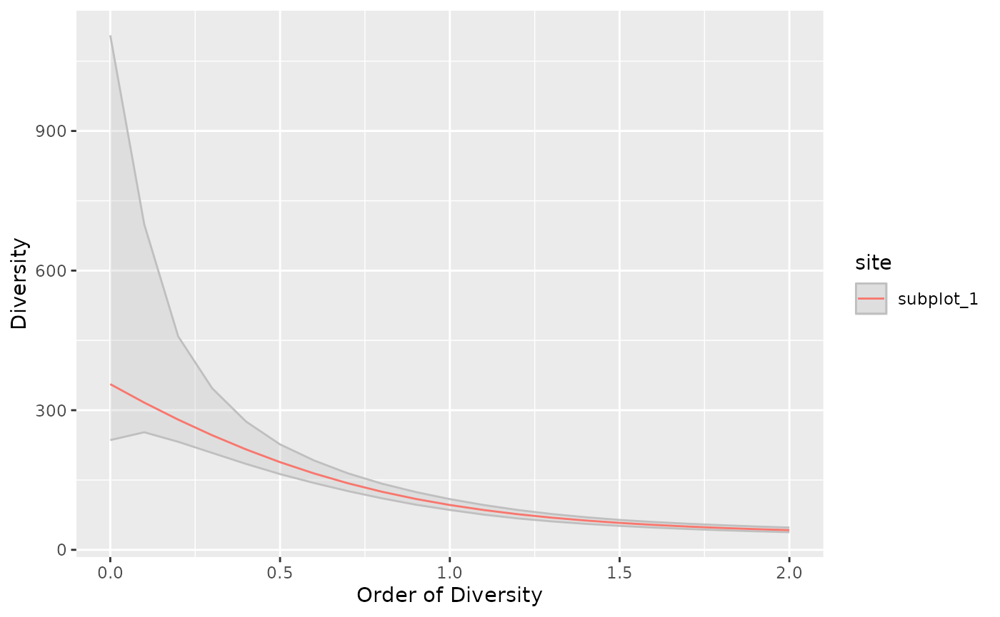

# Parallel computing

Computer-intensive tasks can be run in parallel thanks to the **future**
and **doFuture** (Bengtsson 2021) packages.

The following functions are concerned:

- [`profile_hill()`](https://ericmarcon.github.io/divent/dev/reference/profile_hill.md)
- [`profile_similarity()`](https://ericmarcon.github.io/divent/dev/reference/profile_similarity.md)
- [`accum_sp_tsallis()`](https://ericmarcon.github.io/divent/dev/reference/accum_sp_hill.md)
- [`accum_sp_hill()`](https://ericmarcon.github.io/divent/dev/reference/accum_sp_hill.md)

## Progress bar

These functions can report their progress thanks to the **progressr**
package.

The progress bar must be activated and its interface chosen. Since all
progress bars rely on package *cli* in divent, the “cli” handler is a
good choice.

``` r

library("progressr")
handlers("cli", global = TRUE)
```

## Example

The diversity profile of example data is computed sequentially. The
computing time is measured.

``` r

library("divent")
system.time(
  the_profile <- profile_hill(paracou_6_abd[1,], n_simulations = 100)
)
```

    ##    user  system elapsed 
    ##  11.528   0.017  11.545

``` r

autoplot(the_profile)
```



## Parallel plan

It can be parallelized by setting a hardware strategy. The following
example launches several simultaneous copies of R on the local computer:
it works on all operating systems. The number of parallel processes here
is the number of logical CPUs.

``` r

library("future")
plan(multisession, workers = availableCores())
```

The same computation is now run faster.

``` r

system.time(
  the_profile <- profile_hill(paracou_6_abd[1,], n_simulations = 100)
)
```

    ##    user  system elapsed 
    ##   0.675   0.008   7.281

The default strategy is `sequential`. It should be restored.

``` r

plan(sequential)
```

Other possible strategies are forking (`multicore`), unavailable on
Windows, and `cluster`, on several computers.

See the documentation of the *future* package, namely
[`future::plan()`](https://future.futureverse.org/reference/plan.html).

## Limits

Setting up the parallel code and gathering the results takes time so the
performance of sequential simulations may be better if they are fast.

## References

Bengtsson, Henrik. 2021. “A Unifying Framework for Parallel and
Distributed Processing in R Using Futures.” *The R Journal* 13 (2): 208.
<https://doi.org/10.32614/RJ-2021-048>.
